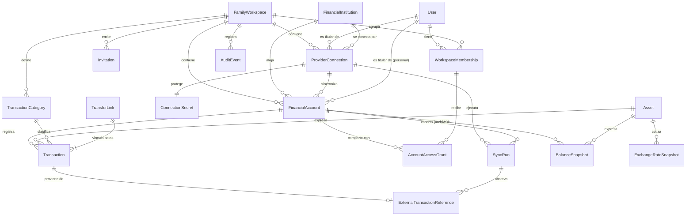

# Modelo de dominio — Finanzas personales y familiares

| Campo | Valor |
|---|---|
| Estado | Borrador conceptual para aprobación. **No implementado.** |
| Fecha | 2026-10-12 |
| Relacionado | [PRD.md](PRD.md) · [ARCHITECTURE.md](ARCHITECTURE.md) · [DECISIONS.md](DECISIONS.md) |

> Este documento describe conceptos, no clases Java ni tablas SQL definitivas. Los tipos sugeridos (`NUMERIC`, `UUID`) orientan la implementación futura, que deberá aprobarse por separado.

---

## 1. Convenciones generales

| Tema | Convención |
|---|---|
| Identificadores | UUID (versión 7, ordenable por tiempo) generados por el backend. No se exponen identificadores secuenciales. |
| Aislamiento | Toda entidad con datos financieros o personales del espacio lleva `workspace_id`. Las consultas siempre filtran por él (ARCHITECTURE §6.1). |
| Importes | Siempre un par **(cantidad, activo)**. Cantidad decimal exacta (`NUMERIC(38,18)` en PostgreSQL, `BigDecimal` en Java, *string* decimal en JSON). Nunca `float`, `double` ni `number` de JS. |
| Signo | Las cantidades de los movimientos son **positivas**; el sentido lo da `direction` (`IN`/`OUT`). Evita errores de doble negación. |
| Fechas | Instantes en UTC (`timestamptz`). La fecha de operación también se guarda como fecha local del espacio, para los reportes por día. |
| Auditoría | `created_at`, `created_by`, `updated_at`, `updated_by` en entidades editables; los cambios sensibles generan un `AuditEvent`. |
| Borrado | Lógico (estado o `deleted_at`). El borrado físico solo ocurre por retención o por pedido del titular, con un proceso explícito. |
| Concurrencia | Bloqueo optimista (`version`) en entidades editables. |

---

## 2. Revisión de la lista de entidades propuesta

| Entidad propuesta | Decisión | Justificación |
|---|---|---|
| User | **Se mantiene** | Identidad de la persona; independiente de los espacios. |
| FamilyWorkspace | **Se mantiene** | Unidad de aislamiento (*tenant*). |
| WorkspaceMembership | **Se mantiene** | Relación usuario–espacio con rol y ciclo de vida; conserva el historial cuando alguien sale. |
| Invitation | **Se mantiene** | Ciclo de vida propio (pendiente, aceptada, vencida, revocada). |
| FinancialInstitution | **Se mantiene** | Catálogo de entidades; distinta de la cuenta. |
| ProviderConnection | **Se mantiene** | Consentimiento y estado técnico; distinta de la cuenta y de la entidad. |
| FinancialAccount | **Se mantiene** | Contenedor de saldos. |
| Asset | **Se mantiene** | Unidad de los importes (fiat y cripto). |
| Transaction | **Se mantiene** | Un movimiento en una cuenta y un activo (una "pata"). |
| TransactionCategory | **Se mantiene** | Clasificación de ingresos y gastos. |
| TransferLink | **Se mantiene, ampliada** | Vincula las patas de una transferencia propia **y** de una conversión entre activos (mismo concepto económico: dinero propio que cambia de lugar o de forma, neutro para el resultado). |
| BalanceSnapshot | **Se mantiene, ampliada** | Además del saldo informado por el proveedor, guarda el **saldo declarado** que sirve de ancla a las cuentas manuales (evita crear ingresos ficticios). |
| ExchangeRateSnapshot | **Se mantiene** | Historial inmutable de cotizaciones. |
| SyncRun | **Se mantiene, ampliada** | Representa también las **importaciones de archivos**, para que ambas vías compartan trazabilidad y deduplicación. |
| ExternalTransactionReference | **Se mantiene, ampliada** | Además del identificador externo, guarda el **dato original del proveedor** (separado del dato normalizado y editable). |
| AuditEvent | **Se mantiene** | Registro inmutable de acciones sensibles. |
| **AccountAccessGrant** | **Se agrega** | Hace falta para la visibilidad `SELECCIONADA` y para los niveles de permiso por cuenta (PRD FR-WS-11, FR-WS-13). Sin ella, la visibilidad solo podría ser "todos" o "nadie". |
| **ConnectionSecret** | **Se agrega** | Separa el material criptográfico (tokens, API keys cifradas) de `ProviderConnection`, para que el resto del sistema pueda leer el estado de una conexión sin tener acceso a sus secretos (ARCHITECTURE §6.3). |
| **WorkspacePreferences** | **Se agrega como objeto de valor** de FamilyWorkspace | El PRD pide "Preferencias del espacio". No necesita identidad propia; se guarda 1:1 con el espacio. |
| **Role** | **Enumeración, no entidad** | Los roles son fijos en el MVP (Propietario, Administrador, Miembro). Una entidad solo se justificaría con roles personalizables, que no están en el alcance. |
| **Network** (red blockchain) | **Catálogo de referencia, no entidad de negocio** | Es un dato de referencia (`TRON`, `ETHEREUM`…) usado por Transaction y Asset. No tiene ciclo de vida de negocio. |
| **TransactionReview** | **No se agrega por ahora** | Las sugerencias de transferencia y los posibles duplicados se representan con `TransferLink` en estado `SUGERIDA` y con el estado de sincronización `CONFLICTO`. Se revisará si la bandeja de revisión crece en complejidad. |
| **Budget, Goal** | **No se agregan** | Fuera del alcance del MVP. |

---

## 3. Diagrama de relaciones



---

## 4. Entidades

### 4.1 User

| Aspecto | Definición |
|---|---|
| **Responsabilidad** | Representar a una persona autenticada. No contiene datos financieros. |
| **Identificador** | `user_id` (UUID). Se vincula al sujeto (`sub`) del proveedor de identidad OIDC. |
| **Atributos** | `idp_subject`, `email`, `email_verified`, `display_name`, `locale`, `status`, `created_at`. |
| **Relaciones** | 0..n `WorkspaceMembership`; titular de 0..n `FinancialAccount` personales y de 0..n `ProviderConnection`. |
| **Integridad** | `email` normalizado (minúsculas). No se guarda la contraseña: la autenticación la resuelve el IdP. |
| **Unicidad** | `idp_subject` único; `email` único entre usuarios activos. |
| **Autorización** | Cada usuario ve y edita su propio perfil. Los demás integrantes de un espacio ven solo su `display_name` y, si corresponde, el correo. |
| **Ciclo de vida** | `ACTIVO` → `SUSPENDIDO` (seguridad) → `ACTIVO`; `ACTIVO` → `BAJA_SOLICITADA` → `ELIMINADO` (se anonimiza: los movimientos que registró en cuentas compartidas quedan atribuidos a "usuario eliminado"). |

### 4.2 FamilyWorkspace

| Aspecto | Definición |
|---|---|
| **Responsabilidad** | Unidad de aislamiento de datos y de colaboración. Un usuario individual tiene un espacio con un solo integrante. |
| **Identificador** | `workspace_id` (UUID). |
| **Atributos** | `name`, `status`, `preferences` (objeto de valor), `deletion_requested_at`, `deletion_scheduled_for`. |
| **WorkspacePreferences** | `reference_asset` (ARS, fijo en el MVP), `usd_valuation_rate_type` (decisión D-04), `timezone` (por defecto `America/Argentina/Buenos_Aires`), `default_shared_account_visibility`. **No** existe una preferencia que haga visibles por defecto las cuentas personales (PRD FR-WS-12). |
| **Relaciones** | 1..n `WorkspaceMembership` (≥ 1 Propietario activo); 0..n cuentas, conexiones, categorías, invitaciones y eventos de auditoría. |
| **Integridad** | Siempre debe tener al menos un Propietario activo (se valida en la transacción que modifica membresías). |
| **Unicidad** | Ninguna por nombre (dos familias pueden llamarse igual). |
| **Autorización** | Leer: integrantes activos. Editar nombre y preferencias: Propietario y Administrador. Eliminar: solo Propietario, con reautenticación. |
| **Ciclo de vida** | `ACTIVO` → `ELIMINACION_PROGRAMADA` (se bloquea el acceso y se revocan las conexiones; se puede cancelar durante el período de gracia, D-09) → `ELIMINADO` (borrado definitivo de los datos financieros; se conservan solo los eventos de auditoría mínimos que exija la ley). |

### 4.3 WorkspaceMembership

| Aspecto | Definición |
|---|---|
| **Responsabilidad** | Relación entre un usuario y un espacio, con su rol. Conserva el historial de quién perteneció y cuándo. |
| **Identificador** | `membership_id` (UUID). |
| **Atributos** | `workspace_id`, `user_id`, `role` (`OWNER`, `ADMIN`, `MEMBER`), `status`, `joined_at`, `ended_at`, `end_reason` (`LEFT`, `REMOVED`, `WORKSPACE_DELETED`), `ended_by`, `invitation_id`. |
| **Relaciones** | N:1 con User y con FamilyWorkspace; 0..n `AccountAccessGrant`. |
| **Integridad** | Una membresía `FINALIZADA` no vuelve a `ACTIVA`: si la persona regresa, se crea una nueva (preserva el historial). |
| **Unicidad** | Una sola membresía `ACTIVA` por (`workspace_id`, `user_id`) — índice único parcial. |
| **Autorización** | Ver la lista de integrantes: integrantes activos. Cambiar roles: Propietario. Quitar: según la matriz del PRD §5.G. |
| **Ciclo de vida** | `ACTIVA` → `FINALIZADA`. Al finalizar se ejecutan, en la misma transacción o mediante un proceso confiable: revocación de *grants*, revocación de conexiones en el espacio, archivo de cuentas personales (D-08) y evento de auditoría. |

### 4.4 Invitation

| Aspecto | Definición |
|---|---|
| **Responsabilidad** | Invitar a una persona a un espacio con un rol. |
| **Identificador** | `invitation_id` (UUID). El *token* que viaja en el enlace es aleatorio (≥ 128 bits) y solo se guarda su **hash**. |
| **Atributos** | `workspace_id`, `email`, `role`, `token_hash`, `invited_by`, `status`, `expires_at`, `accepted_at`, `accepted_by`, `revoked_at`. |
| **Relaciones** | N:1 con FamilyWorkspace; 0..1 `WorkspaceMembership` creada al aceptarla. |
| **Integridad** | El rol invitado no puede superar lo permitido al invitador (PRD FR-WS-20). Solo la acepta un usuario con `email_verified` igual al de la invitación. |
| **Unicidad** | Una sola invitación `PENDIENTE` por (`workspace_id`, `email`). |
| **Autorización** | Crear y revocar: Propietario (cualquier rol salvo Propietario); Administrador (solo Miembro). Aceptar: el destinatario. |
| **Ciclo de vida** | `PENDIENTE` → `ACEPTADA` \| `VENCIDA` \| `REVOCADA`. Son estados finales. |

### 4.5 FinancialInstitution

| Aspecto | Definición |
|---|---|
| **Responsabilidad** | Catálogo global de entidades financieras y de sus capacidades de integración. |
| **Identificador** | `institution_id` (UUID) + `code` estable (`BINANCE`, `MERCADO_PAGO`, `GALICIA`…). |
| **Atributos** | `name`, `type` (`BANK`, `WALLET`, `EXCHANGE`, `OTHER`), `country`, `integration_capabilities` (descriptor: `mechanism` [`OAUTH`, `READONLY_API_KEY`, `OPEN_FINANCE`, `FILE_IMPORT`, `MANUAL`], `supports_balances`, `supports_transactions`, `supports_incremental`, `supports_webhooks`, `max_history_window`, `assessment_status`), `supported_file_formats`, `status`. |
| **Relaciones** | 0..n `ProviderConnection`; 0..n `FinancialAccount`. |
| **Integridad** | `assessment_status` refleja [INTEGRATIONS_ASSESSMENT.md](INTEGRATIONS_ASSESSMENT.md); la conexión automática solo se ofrece si el estado lo permite (PRD FR-IN-07). |
| **Unicidad** | `code` único. |
| **Autorización** | Lectura para todos los usuarios autenticados; escritura solo por el equipo operador (datos de referencia, migraciones o administración interna). |
| **Ciclo de vida** | `ACTIVA` → `DESHABILITADA` (no admite conexiones nuevas; las cuentas existentes siguen funcionando en modo manual o por archivo). |

### 4.6 ProviderConnection

| Aspecto | Definición |
|---|---|
| **Responsabilidad** | Representar el **consentimiento** de un usuario para que la app lea datos de una entidad, y el estado técnico de esa conexión. No contiene secretos. |
| **Identificador** | `connection_id` (UUID). |
| **Atributos** | `workspace_id`, `institution_id`, `owner_user_id` (quien otorgó el consentimiento), `mechanism`, `granted_scopes`, `consented_at`, `expires_at`, `status`, `last_successful_sync_at`, `last_attempted_sync_at`, `last_error_class`, `sync_cursor` (por cuenta externa, si el proveedor lo usa), `external_user_ref` (identificador del usuario en el proveedor, si existe). |
| **Relaciones** | 1:1 `ConnectionSecret`; 0..n `FinancialAccount` sincronizadas; 0..n `SyncRun`. |
| **Integridad** | Solo lectura: `granted_scopes` no puede incluir permisos de escritura (PRD FR-SY-17); si se detectan, la conexión se rechaza. Una conexión `REVOCADA` no vuelve a `ACTIVA`: se crea una nueva y las cuentas se revinculan por `external_account_ref`. |
| **Unicidad** | Una conexión no revocada por (`workspace_id`, `owner_user_id`, `institution_id`, `external_user_ref`). |
| **Autorización** | Ver el estado: quien pueda ver alguna de sus cuentas. Reautorizar o revocar: **solo** `owner_user_id`. Propietario y Administrador pueden **pausar** la sincronización de una cuenta compartida, pero nunca acceder al secreto. El sistema la revoca si el titular deja el espacio. |
| **Ciclo de vida** | `PENDIENTE_CONSENTIMIENTO` → `ACTIVA` ⇄ `ERROR_TRANSITORIO` → `REQUIERE_REAUTORIZACION` → `ACTIVA`; cualquier estado → `REVOCADA` (por el usuario, por el proveedor o por el sistema). `PAUSADA` es reversible. |

### 4.7 ConnectionSecret (agregada)

| Aspecto | Definición |
|---|---|
| **Responsabilidad** | Guardar cifrado el material de credenciales (access y refresh token OAuth, API key y su secreto). |
| **Identificador** | `connection_id` (1:1). |
| **Atributos** | `ciphertext`, `wrapped_data_key`, `kek_id` y versión de la clave maestra, `algorithm`, `rotated_at`, `expires_at`. Nunca el valor en claro. |
| **Relaciones** | 1:1 `ProviderConnection`. |
| **Integridad** | Solo el módulo de integraciones puede leerlo; se descifra en memoria al sincronizar. No aparece en logs, respuestas de la API, exportaciones ni respaldos sin cifrar. |
| **Unicidad** | Uno por conexión. |
| **Autorización** | Ningún usuario lo lee: ni siquiera su titular puede recuperar el valor (solo puede reemplazarlo o revocarlo). |
| **Ciclo de vida** | Creado al conectar → reemplazado al renovar o reautorizar → **destruido** al revocar (borrado físico del texto cifrado; *crypto-shredding*). |

### 4.8 FinancialAccount

| Aspecto | Definición |
|---|---|
| **Responsabilidad** | Contenedor de saldos de uno o varios activos dentro de una entidad, o una cuenta manual. |
| **Identificador** | `account_id` (UUID). |
| **Atributos** | `workspace_id`, `institution_id` (nulo para efectivo u otras), `name`, `type` (`BANK_ACCOUNT`, `WALLET`, `CREDIT_CARD`, `EXCHANGE_ACCOUNT`, `CASH`, `OTHER`), `nature` (`ASSET` o `LIABILITY`; la tarjeta de crédito es `LIABILITY`), `ownership` (`PERSONAL` o `SHARED`), `owner_user_id` (obligatorio si es `PERSONAL`), `visibility` (`PRIVATE`, `WORKSPACE`, `SELECTED`), `asset_mode` (`SINGLE` o `MULTI`), `base_asset_id` (obligatorio si es `SINGLE`), `source_mode` (`MANUAL`, `SYNCED`, `FILE_IMPORT`), `connection_id`, `external_account_ref`, `masked_identifier` (p. ej. últimos 4 dígitos; nunca el número completo), `status`. |
| **Relaciones** | N:1 FamilyWorkspace, FinancialInstitution, ProviderConnection; 0..n Transaction, BalanceSnapshot, AccountAccessGrant. |
| **Integridad** | `PERSONAL` ⇒ `owner_user_id` no nulo. `SHARED` ⇒ `owner_user_id` nulo. `SINGLE` ⇒ todos sus movimientos y saldos usan `base_asset_id`. Una cuenta `PERSONAL` no puede crearse con visibilidad distinta de `PRIVATE` salvo por acción explícita del titular. |
| **Unicidad** | (`workspace_id`, `institution_id`, `external_account_ref`) único cuando `external_account_ref` no es nulo: así una reconexión se revincula a la misma cuenta y no la duplica. |
| **Autorización** | Ver: titular, o visibilidad `WORKSPACE` para integrantes activos, o `AccountAccessGrant` vigente. Cambiar visibilidad y *grants*: titular (personal) o Propietario/Administrador (compartida). |
| **Ciclo de vida** | `ACTIVA` → `DESCONECTADA` (conexión revocada; sigue manual o por archivo) → `ACTIVA` (si se reconecta); `ACTIVA` → `ARCHIVADA` (solo lectura) → `ACTIVA`; `ARCHIVADA` → `ELIMINADA` (por el titular o por retención; borrado definitivo por proceso explícito). |

### 4.9 AccountAccessGrant (agregada)

| Aspecto | Definición |
|---|---|
| **Responsabilidad** | Permiso explícito de un integrante sobre una cuenta. |
| **Identificador** | `grant_id` (UUID). |
| **Atributos** | `workspace_id`, `account_id`, `membership_id`, `level` (`VIEW_BALANCE` < `VIEW_TRANSACTIONS` < `RECORD` < `MANAGE`), `granted_by`, `granted_at`, `revoked_at`, `revoked_by`. |
| **Relaciones** | N:1 FinancialAccount y WorkspaceMembership. |
| **Integridad** | La cuenta y la membresía pertenecen al mismo espacio. No se otorgan permisos a membresías finalizadas. Los niveles son acumulativos. |
| **Unicidad** | Un solo *grant* vigente por (`account_id`, `membership_id`). |
| **Autorización** | Otorgar y revocar: titular (personal) o Propietario/Administrador (compartida). |
| **Ciclo de vida** | `VIGENTE` → `REVOCADO` (por un usuario, o automáticamente al finalizar la membresía o archivar la cuenta). Nunca se borra. |

### 4.10 Asset

| Aspecto | Definición |
|---|---|
| **Responsabilidad** | Unidad en la que se expresa una cantidad. |
| **Identificador** | `asset_id` (UUID) + `code` (`ARS`, `USD`, `BTC`, `USDT`). |
| **Atributos** | `kind` (`FIAT` o `CRYPTO`), `name`, `decimals` (ARS 2, USD 2, BTC 8, otros hasta 18), `iso_4217` (solo fiat), `enabled`, `external_ids` (identificadores en fuentes de precio y en proveedores). |
| **Red** | Catálogo `Network` (`code`, `name`). La red se registra en el movimiento cuando es relevante (depósito o retiro en una red), no en el activo: USDT es un único activo, aunque se pueda transferir por varias redes. Si en el futuro se agregan billeteras propias, se evaluará incorporar el par (activo, red, contrato del token). |
| **Relaciones** | 0..n Transaction, BalanceSnapshot, ExchangeRateSnapshot. |
| **Integridad** | Toda cantidad respeta `decimals` del activo (la escala se valida al guardar). Un `code` de cripto no es único a nivel mundial; se resuelve con `external_ids`. |
| **Unicidad** | (`kind`, `code`) único. |
| **Autorización** | Lectura para todos; escritura por el equipo operador. Un activo desconocido que llega de una sincronización se crea `enabled = false` y queda para revisión (PRD FR-MC-12). |
| **Ciclo de vida** | `HABILITADO` ⇄ `DESHABILITADO` (deshabilitar no borra datos, solo impide nuevas cargas manuales). |

### 4.11 Transaction

| Aspecto | Definición |
|---|---|
| **Responsabilidad** | Un cambio de saldo en **una** cuenta y en **un** activo. Contiene los datos **normalizados y editables**. |
| **Identificador** | `transaction_id` (UUID). |
| **Atributos** | `workspace_id`, `account_id`, `asset_id`, `direction` (`IN`/`OUT`), `amount` (> 0), `kind` (`INCOME`, `EXPENSE`, `TRANSFER`, `ADJUSTMENT`), `status` (`PENDING`, `CONFIRMED`, `REVERSED`, `CANCELLED`, `DELETED`), `origin` (`MANUAL`, `SYNC`, `FILE_IMPORT`), `operation_date` (local) y `operation_at` (UTC, si se conoce), `recorded_at`, `category_id`, `description`, `notes`, `counterparty` (texto o identificador enmascarado), `network_code` (opcional), `sync_state` (`IN_SYNC`, `CONFLICT`, `MISSING_AT_PROVIDER`, `NOT_APPLICABLE`), `user_overrides` (conjunto de campos editados por el usuario), `transfer_link_id`, `reverses_transaction_id`, `excluded_from_reports` + `exclusion_reason`, `created_by`, `version`. |
| **Relaciones** | N:1 FinancialAccount, Asset, TransactionCategory, TransferLink; 0..1 ExternalTransactionReference; 0..1 movimiento revertido. |
| **Integridad** | `INCOME` ⇒ `IN`; `EXPENSE` ⇒ `OUT`; `TRANSFER` ⇒ `transfer_link_id` no nulo; `ADJUSTMENT` ⇒ requiere motivo (D-05). Si la cuenta es `SINGLE`, `asset_id = base_asset_id`. `amount` con la escala del activo. La cuenta, la categoría y el *link* pertenecen al mismo `workspace_id`. Un movimiento importado no cambia de cuenta. |
| **Unicidad** | Ver ExternalTransactionReference. Los movimientos manuales aceptan una clave de idempotencia del cliente: (`workspace_id`, `created_by`, `idempotency_key`) único durante 24 h. |
| **Autorización** | Ver: con ≥ `VIEW_TRANSACTIONS` sobre la cuenta. Crear: con ≥ `RECORD`. Editar movimientos de otros o importados: con `MANAGE` (o titular, o Propietario/Administrador en cuentas compartidas). Los campos crudos del proveedor no son editables. |
| **Ciclo de vida** | Ver §5.2. |

### 4.12 TransactionCategory

| Aspecto | Definición |
|---|---|
| **Responsabilidad** | Clasificar ingresos y gastos para los reportes. |
| **Identificador** | `category_id` (UUID). |
| **Atributos** | `workspace_id` (nulo para las categorías del sistema), `name`, `applies_to` (`INCOME`, `EXPENSE`), `parent_id` (máximo 2 niveles), `system_code` (p. ej. `FEES` para comisiones), `status`. |
| **Relaciones** | 0..n Transaction; jerarquía padre–hijo. |
| **Integridad** | Las transferencias no llevan categoría de ingreso o gasto. Una categoría con movimientos no se borra: se archiva y se puede fusionar con otra (reasignación auditada). |
| **Unicidad** | (`workspace_id`, `parent_id`, `name`) único entre las activas. |
| **Autorización** | Ver: integrantes. Crear, editar o archivar: Propietario y Administrador (propuesta; podría habilitarse a Miembros). |
| **Ciclo de vida** | `ACTIVA` → `ARCHIVADA` → `ACTIVA`. |

### 4.13 TransferLink

| Aspecto | Definición |
|---|---|
| **Responsabilidad** | Vincular las patas de una transferencia entre cuentas propias o de una conversión entre activos, para que el conjunto sea neutro en el resultado. |
| **Identificador** | `transfer_link_id` (UUID). |
| **Atributos** | `workspace_id`, `type` (`OWN_TRANSFER` mismo activo; `CONVERSION` activos distintos), `status` (`SUGGESTED`, `CONFIRMED`, `REJECTED`), `detection` (`MANUAL`, `AUTO_DETERMINISTIC`, `AUTO_SUGGESTED`), `confidence_signals` (qué coincidió: importe, fecha, CBU/CVU, referencia), `implied_rate` (solo informativo en una conversión), `confirmed_by`, `confirmed_at`. |
| **Relaciones** | 2..n Transaction: exactamente una pata `OUT` principal y una `IN` principal; opcionalmente patas de comisión (`EXPENSE` con categoría `FEES`) vinculadas. |
| **Integridad** | Todas las patas en el mismo espacio. `OWN_TRANSFER`: mismo activo, y la cantidad que sale = la que entra + comisiones explícitas (diferencia cero; si no cierra, el *link* no puede confirmarse). `CONVERSION`: activos distintos; cada pata conserva su cantidad; `implied_rate` = cantidad que entra ÷ cantidad que sale, nunca se usa como cotización de mercado. Al confirmar, las patas principales pasan a `kind = TRANSFER`; al rechazar, recuperan su tipo anterior. |
| **Unicidad** | Un movimiento pertenece como máximo a un *link* `CONFIRMED`. Puede figurar en varios `SUGGESTED`; al confirmar uno, los demás se rechazan. |
| **Autorización** | Ver, confirmar o rechazar: solo quien puede ver **todas** las patas (PRD FR-TX-10). Crear manualmente: con ≥ `RECORD` en ambas cuentas. |
| **Ciclo de vida** | `SUGGESTED` → `CONFIRMED` \| `REJECTED`; `CONFIRMED` → `REJECTED` (desvincular, auditado). |

### 4.14 BalanceSnapshot

| Aspecto | Definición |
|---|---|
| **Responsabilidad** | Registrar el saldo de un activo en una cuenta en un momento dado, con su origen. Sirve de **ancla** para calcular saldos y para conciliar. |
| **Identificador** | `snapshot_id` (UUID). |
| **Atributos** | `workspace_id`, `account_id`, `asset_id`, `quantity` (puede ser negativa en un pasivo), `as_of` (instante del saldo), `source` (`PROVIDER_REPORTED`, `USER_DECLARED`, `COMPUTED`), `sync_run_id`, `is_anchor`, `created_by`. |
| **Relaciones** | N:1 FinancialAccount, Asset, SyncRun. |
| **Integridad** | Inmutable (se agregan nuevos, no se editan). Respeta la escala del activo. |
| **Unicidad** | (`account_id`, `asset_id`, `source`, `as_of`) único. |
| **Autorización** | Ver: con ≥ `VIEW_BALANCE`. Declarar un saldo (`USER_DECLARED`): con ≥ `RECORD`. |
| **Ciclo de vida** | Creado e inmutable; se elimina solo junto con la cuenta. |

### 4.15 ExchangeRateSnapshot

| Aspecto | Definición |
|---|---|
| **Responsabilidad** | Historial inmutable de cotizaciones para valuar activos en ARS. |
| **Identificador** | `rate_id` (UUID). |
| **Atributos** | `base_asset_id` (p. ej. USD), `quote_asset_id` (p. ej. ARS), `rate_type` (`OFFICIAL_RETAIL`, `OFFICIAL_WHOLESALE`, `MEP`, `CCL`, `CRYPTO_MARKET`; el catálogo final depende de D-04), `source` (nombre de la fuente), `bid`, `ask`, `mid` (los que informe la fuente), `quoted_at` (momento que informa la fuente), `fetched_at`. |
| **Relaciones** | N:1 Asset (base y cotización). Global: no pertenece a un espacio. |
| **Integridad** | Valores > 0. Inmutable. Una valuación guarda **qué** `rate_id` usó, para poder reproducirla. Si no hay cotización directa (p. ej. BTC→ARS), se permite una cadena (BTC→USDT→ARS) y se guardan todos los `rate_id` usados. |
| **Unicidad** | (`base_asset_id`, `quote_asset_id`, `rate_type`, `source`, `quoted_at`) único. |
| **Autorización** | Lectura para usuarios autenticados; escritura solo por el proceso de ingesta de cotizaciones. |
| **Ciclo de vida** | Creado e inmutable. Se pueden compactar datos antiguos (p. ej. una cotización por día para períodos de más de un año), conservando las que use alguna valuación guardada. |

### 4.16 SyncRun

| Aspecto | Definición |
|---|---|
| **Responsabilidad** | Registrar cada ejecución de sincronización por API o de importación de archivo: qué se pidió, qué se obtuvo, qué se creó o actualizó, y cómo terminó. |
| **Identificador** | `sync_run_id` (UUID). |
| **Atributos** | `workspace_id`, `kind` (`API_INITIAL`, `API_INCREMENTAL`, `FILE_IMPORT`), `connection_id` (en API), `account_id` (en archivo), `file_sha256` y `file_name` (en archivo), `trigger` (`SCHEDULED`, `USER`, `RETRY`), `attempt`, `status` (`QUEUED`, `RUNNING`, `SUCCEEDED`, `PARTIAL`, `FAILED`, `CANCELLED`), `requested_range`, `covered_range`, `cursor_before`, `cursor_after`, contadores (`fetched`, `created`, `updated`, `unchanged`, `conflicts`, `skipped`), `error_class`, `error_detail` (sin secretos ni datos personales), `started_at`, `finished_at`, `next_retry_at`. |
| **Relaciones** | N:1 ProviderConnection o FinancialAccount; 0..n ExternalTransactionReference observadas; 0..n BalanceSnapshot. |
| **Integridad** | Como máximo una ejecución `RUNNING` por conexión (índice único parcial). `cursor_after` solo se persiste cuando se confirma el tramo correspondiente. |
| **Unicidad** | Para un archivo: (`account_id`, `file_sha256`) identifica una reimportación, que se procesa igual pero no crea duplicados. |
| **Autorización** | Ver el resumen: quien vea la cuenta. Ver `error_detail`: titular de la conexión, Propietario y Administrador. Lanzar una sincronización manual: titular de la conexión, o Propietario/Administrador en cuentas compartidas. |
| **Ciclo de vida** | `QUEUED` → `RUNNING` → `SUCCEEDED` \| `PARTIAL` \| `FAILED`; `FAILED` con error transitorio → nueva ejecución `RETRY`; `QUEUED` → `CANCELLED`. Se conserva como historial (retención configurable). |

### 4.17 ExternalTransactionReference

| Aspecto | Definición |
|---|---|
| **Responsabilidad** | Guardar la **identidad externa** y el **dato original** del proveedor (o de la fila del archivo) de un movimiento importado. Es la base de la deduplicación y de la trazabilidad. |
| **Identificador** | `external_ref_id` (UUID). |
| **Atributos** | `workspace_id`, `account_id`, `transaction_id`, `source` (`API` o `FILE`), `external_id` (si el proveedor lo informa), `fingerprint` (huella determinística, §5.4), `occurrence_index`, `raw_payload` (cifrado y minimizado; retención D-12), `raw_amount`, `raw_asset_code`, `raw_operation_at`, `raw_description`, `raw_status`, `payload_hash`, `first_seen_run_id`, `last_seen_run_id`, `last_seen_at`. |
| **Relaciones** | 1:1 Transaction; N:1 SyncRun (primera y última vez que se vio). |
| **Integridad** | Los campos `raw_*` son del proveedor y **nunca** los edita un usuario. Si cambia `payload_hash`, se aplica la regla de §5.1. |
| **Unicidad** | (`account_id`, `external_id`) único cuando `external_id` no es nulo. (`account_id`, `fingerprint`, `occurrence_index`) único cuando `external_id` es nulo. Ambos por cuenta, no por conexión, para que una reconexión no duplique. |
| **Autorización** | Ver campos normalizados: como el movimiento. Ver `raw_payload`: solo el titular de la conexión (PRD §5.G). |
| **Ciclo de vida** | Creada al importar; se actualiza `last_seen_*` en cada sincronización; `raw_payload` se purga al vencer la retención (se conservan el identificador y la huella para seguir deduplicando). |

### 4.18 AuditEvent

| Aspecto | Definición |
|---|---|
| **Responsabilidad** | Registro inmutable de acciones sensibles y cambios de datos. |
| **Identificador** | `event_id` (UUID). |
| **Atributos** | `workspace_id` (nulo para eventos de usuario), `actor_type` (`USER`, `SYSTEM`), `actor_user_id`, `action` (p. ej. `MEMBER_REMOVED`, `GRANT_CHANGED`, `CONNECTION_REVOKED`, `TRANSACTION_EDITED`, `EXPORT_CREATED`), `target_type`, `target_id`, `changes` (campos modificados con el valor anterior y el nuevo, sin secretos y con los datos sensibles enmascarados), `request_id`, `ip_hash`, `occurred_at`. |
| **Relaciones** | Referencias débiles (sin clave foránea obligatoria), para sobrevivir a bajas de otras entidades. |
| **Integridad** | Solo se agregan registros. El rol de base de datos de la aplicación no tiene permisos de `UPDATE` ni `DELETE` sobre la tabla. |
| **Unicidad** | `event_id`. |
| **Autorización** | Ver: según la matriz del PRD §5.G, filtrando a los eventos de recursos que el usuario puede ver. |
| **Ciclo de vida** | Creado e inmutable. Retención por definir (propuesta: 5 años para eventos de seguridad), sujeta a revisión legal. |

---

## 5. Estrategias transversales

### 5.1 Dato del proveedor frente a dato normalizado

```
ExternalTransactionReference (raw_*)  ──normaliza──►  Transaction (campos editables)
        inmutable para el usuario                       user_overrides = {category, description}
```

1. Al importar por primera vez: se crea la referencia con los `raw_*` y se crea el movimiento con los campos normalizados (categoría sugerida por reglas, descripción limpia).
2. Al reimportar con el mismo `payload_hash`: solo se actualiza `last_seen_*`.
3. Al reimportar con un `payload_hash` distinto:
   - Se actualizan los `raw_*`.
   - Para cada campo normalizado que cambió: si **no** está en `user_overrides`, se actualiza; si **sí** está, se conserva el valor del usuario.
   - Si cambió un **campo económico** (importe, activo, dirección o cuenta) se marca `sync_state = CONFLICT` y se pide revisión, aunque el usuario no lo haya editado, porque afecta saldos y reportes ya vistos. El valor que rige hasta la revisión es el del proveedor, salvo que el usuario lo haya editado.
4. Cada actualización aplicada o descartada queda en `AuditEvent`.

### 5.2 Estados del movimiento sin perder trazabilidad

| Estado | Significado | En saldos | En resultado | Transiciones |
|---|---|---|---|---|
| `PENDING` | Informado como pendiente o autorizado por el proveedor | Aparte ("pendiente") | Aparte | → `CONFIRMED`, `CANCELLED` |
| `CONFIRMED` | Firme | Sí | Sí | → `REVERSED`, `DELETED` (solo manuales) |
| `REVERSED` | Revertido por el proveedor (contracargo, devolución que anula) | Neto cero junto con su reversión | Neto cero | Final |
| `CANCELLED` | Pendiente que nunca se confirmó o que el proveedor dejó de informar | No | No | Final |
| `DELETED` | Baja lógica de un movimiento **manual** | No | No | → `CONFIRMED` (restaurar) |

- Una reversión crea un **movimiento nuevo** en sentido opuesto con `reverses_transaction_id`; el original no se modifica (salvo su estado). Así el historial muestra ambos hechos.
- Un movimiento importado no puede pasar a `DELETED`: se puede **excluir** de los reportes (`excluded_from_reports` + motivo). Así sigue deduplicando.
- Si un movimiento `CONFIRMED` deja de aparecer en el proveedor dentro de la ventana que se volvió a consultar, se marca `sync_state = MISSING_AT_PROVIDER` y se pide revisión; no se borra.

### 5.3 Saldos: una sola fuente de verdad por cálculo

No se guarda un saldo "actual" editable que pueda divergir. El saldo se obtiene así:

- **Saldo calculado** de (cuenta, activo) en el instante *t*: el ancla más reciente (`BalanceSnapshot` con `is_anchor`) en *T* más la suma con signo de los movimientos `CONFIRMED` no excluidos en (*T*, *t*]. Si *t* < *T*, se resta hacia atrás.
  - Cuenta manual: el ancla es el saldo `USER_DECLARED` inicial (sin ingreso ficticio).
  - Cuenta sincronizada: el ancla es el primer saldo `PROVIDER_REPORTED` de la sincronización inicial.
- **Saldo informado**: el último `PROVIDER_REPORTED`.
- **Conciliación**: después de cada sincronización se compara el saldo informado con el calculado en el mismo `as_of`. Si difieren, se muestra la diferencia y el usuario elige (según D-05): (a) crear un `ADJUSTMENT` explícito con motivo, o (b) tomar el saldo informado como **nueva ancla**. Nunca se corrige en silencio.
- **Caché**: el MVP **no** materializa saldos; se calculan con índices por (`account_id`, `asset_id`, `operation_at`). Si el rendimiento lo exige, se agregará una tabla de saldos materializados con estas reglas: se actualiza en la misma transacción que el movimiento, se puede reconstruir desde cero, y un proceso periódico verifica que coincida con el cálculo completo (alerta si no).

### 5.4 Deduplicación

1. **Con identificador externo**: *upsert* por (`account_id`, `external_id`). Determinístico; no requiere revisión.
2. **Sin identificador externo** (archivos, algunos proveedores): `fingerprint = SHA-256(account_id | asset | direction | amount normalizado | operation_date local | descripción normalizada)` y `occurrence_index` = orden de aparición entre las filas con la misma huella **dentro del mismo archivo o respuesta**. Reimportar el mismo archivo (u otro que contenga el mismo día completo) produce las mismas claves.
   - Riesgo: dos archivos que cortan un día a la mitad pueden asignar índices distintos. Las coincidencias en los **días de borde** del rango importado se marcan como posibles duplicados para revisión en vez de crearse.
3. **Entre fuentes** (manual frente a importado, o CSV frente a API): coincidencia por cuenta, activo, importe y fecha ±2 días → **sugerencia** de vincular; nunca se fusionan solos (PRD FR-SY-07).

### 5.5 Multimoneda y conversiones sin errores de cálculo

- Cada pata conserva (cantidad, activo). Las sumas se agrupan **por activo**; un total entre activos solo existe como **valuación** (con `rate_id`).
- Una compra de USD 100 con ARS es un `TransferLink` de tipo `CONVERSION`: pata `OUT` ARS *x* en la cuenta en pesos, pata `IN` USD 100 en la cuenta en dólares, y las comisiones o impuestos como patas `EXPENSE` aparte. El resultado (ingresos − gastos) solo cambia por las comisiones o impuestos.
- Un *trade* BTC→USDT en Binance es una `CONVERSION` dentro de la misma cuenta multiactivo (dos patas, misma cuenta, activos distintos), y la comisión es una pata `EXPENSE` en el activo en que se cobró.
- Redondeo: solo al presentar o al guardar una cantidad en la escala de su activo (redondeo `HALF_EVEN`). Las valuaciones se calculan con precisión completa y se redondean al final. La suma de valuaciones redondeadas puede diferir del total en ±1 unidad mínima por activo; se muestra el total calculado con precisión completa.
- La variación de valuación por tipo de cambio **no** es un ingreso ni un gasto (PRD FR-MC-05).

### 5.6 Detección de transferencias

1. **Candidatas**: pares (`OUT` en A, `IN` en B) del mismo espacio, mismo activo, `|t_A − t_B| ≤ 3 días`, importe igual o con una diferencia explicable por una comisión conocida.
2. **Señales**: referencia compartida del proveedor; CBU, CVU o alias de la contraparte que coinciden con `external_account_ref` de una cuenta del espacio; descripción con patrones de transferencia.
3. **Decisión**: si es determinística (referencia compartida, o contraparte identificada + importe y activo exactos), se confirma sola con `detection = AUTO_DETERMINISTIC`, pero puede revisarse; en el resto de los casos queda `SUGGESTED`.
4. **Privacidad**: la detección se ejecuta en el backend; las sugerencias solo se muestran a quien ve ambas cuentas (PRD FR-TX-10).
